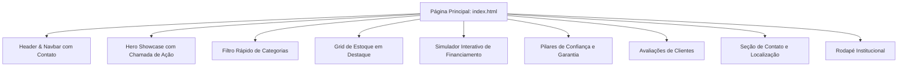

# Arquitetura de Informação e Sitemap
**Estrutura de Páginas e Seções:**

### Detalhamento das Seções:
1. `#home` - Hero Principal com headline de modernização e CTAs principais.
2. `#estoque` - Vitrine dinâmica com filtro instantâneo por categoria.
3. `#simulador` - Calculadora interativa de parcelas.
4. `#diferenciais` - 4 selos de procedência e laudo cautelar.
5. `#depoimentos` - Prova social com feedbacks de clientes reais.
6. `#contato` - Mapa, endereço, horário e botão direto para WhatsApp.
