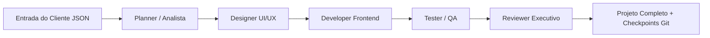

<!--
  ==============================================================
  PORTFÓLIO DE PERFIL GITHUB (README.md)
  Usuário: JoaoAlves0014
  Repositório especial: JoaoAlves0014/JoaoAlves0014
  ==============================================================
-->

  # Olá, eu sou o João Alves 👋
  ### Engenheiro de Software & Arquiteto de Sistemas de IA

  

    <i>Construindo soluções modernas com C#, .NET e Orquestração de Agentes Autônomos de IA.</i>
  

  <!-- Badges de Tecnologias -->
  

    
    
    
    
    
  

  

    
    
  

---

### 🚀 Sobre Mim & Filosofia de Engenharia

Sou desenvolvedor focado em **automação inteligente, engenharia de software robusta e sistemas multi-agentes**.

Acredito fortemente no modelo **Human-in-the-Loop**:
> *"A IA deve assumir 80% a 90% do trabalho repetitivo e previsível, enquanto o engenheiro supervisiona com precisão arquitetural, faz os ajustes criativos e garante excelência na entrega."*

- 🔭 **Atualmente focado em:** Desenvolvimento de orquestradores de IA em .NET e automação de desenvolvimento web.
- ⚡ **Stack Principal:** C# / .NET 8, Arquitetura Limpa, Pipelines de IA, Vanilla Web & APIs.
- 🎯 **Objetivo:** Criar ferramentas que multiplicam por 10 a produtividade de engenharia de software sem abrir mão de controle e qualidade.

---

### 🌟 Projeto em Destaque: **SiteFactory**

> **Fábrica de Sites Multi-Agentes com C# (.NET 8)**

O **SiteFactory** é um orquestrador que coordena uma esteira sequencial de agentes especializados para gerar sites modernos e funcionais a partir de uma especificação JSON do cliente:

- **Pipeline de 5 Agentes:** Planejamento estratégico, Design System moderno, código semântico, validação técnica automatizada (QA) e auditoria executiva.
- **Checkpoints com Git:** Cada agente cria automaticamente commits no histórico do projeto do cliente.
- **Supervisão no VS Code:** Ambiente voltado para inspeção rápida de diffs e supervisão humana.

---

### 🛠️ Tecnologias & Competências

<table>
  <tr>
    <td width="50%" valign="top">
      <h4>💻 Backend & Arquitetura</h4>
      <ul>
        <li><b>C# / .NET 8</b> (Console Apps, Web APIs, Worker Services)</li>
        <li>Clean Architecture & Domain-Driven Design</li>
        <li>State Machines & Orchestration Pipelines</li>
        <li>Controle de Versão Git automatizado</li>
      </ul>
    </td>
    <td width="50%" valign="top">
      <h4>🤖 Engenharia de IA & Agentes</h4>
      <ul>
        <li>Arquiteturas Multi-Agentes & Human-in-the-Loop</li>
        <li>Prompt Engineering estruturado</li>
        <li>Automação de workflows de desenvolvimento</li>
        <li>Integrações com APIs de LLMs (Gemini, Claude, Codex)</li>
      </ul>
    </td>
  </tr>
  <tr>
    <td width="50%" valign="top">
      <h4>🎨 Frontend & Web</h4>
      <ul>
        <li>HTML5 Semântico & Acessibilidade (WCAG)</li>
        <li>CSS3 Moderno (Custom Properties, Grid, Flexbox, Glassmorphism)</li>
        <li>JavaScript Moderno (ES6+) sem dependências pesadas</li>
        <li>Design Systems e Microinterações</li>
      </ul>
    </td>
    <td width="50%" valign="top">
      <h4>⚙️ Ferramentas & Práticas</h4>
      <ul>
        <li>Visual Studio / VS Code</li>
        <li>Git & GitHub Workflows / Checkpoints</li>
        <li>Testes Automatizados & Relatórios de QA</li>
        <li>CI/CD & GitHub Pages</li>
      </ul>
    </td>
  </tr>
</table>

---

### 📊 Estatísticas do GitHub

  
  

  

---

### 📬 Conecte-se comigo

Se você busca automatizar processos de engenharia com IA, desenvolver orquestradores robustos em .NET ou trocar ideias sobre o futuro do desenvolvimento:

- 🐙 **GitHub:** [github.com/JoaoAlves0014](https://github.com/JoaoAlves0014)
- 🌐 **Portfólio Web:** [https://joaoalves0014.github.io](https://joaoalves0014.github.io)
